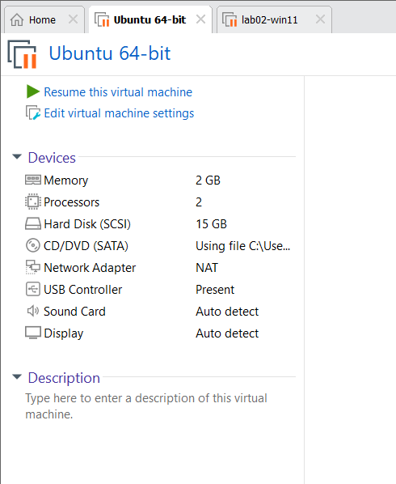
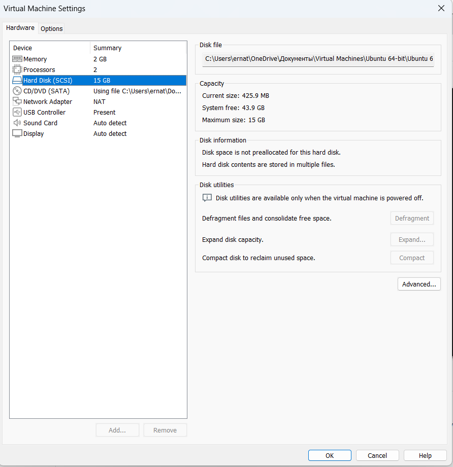
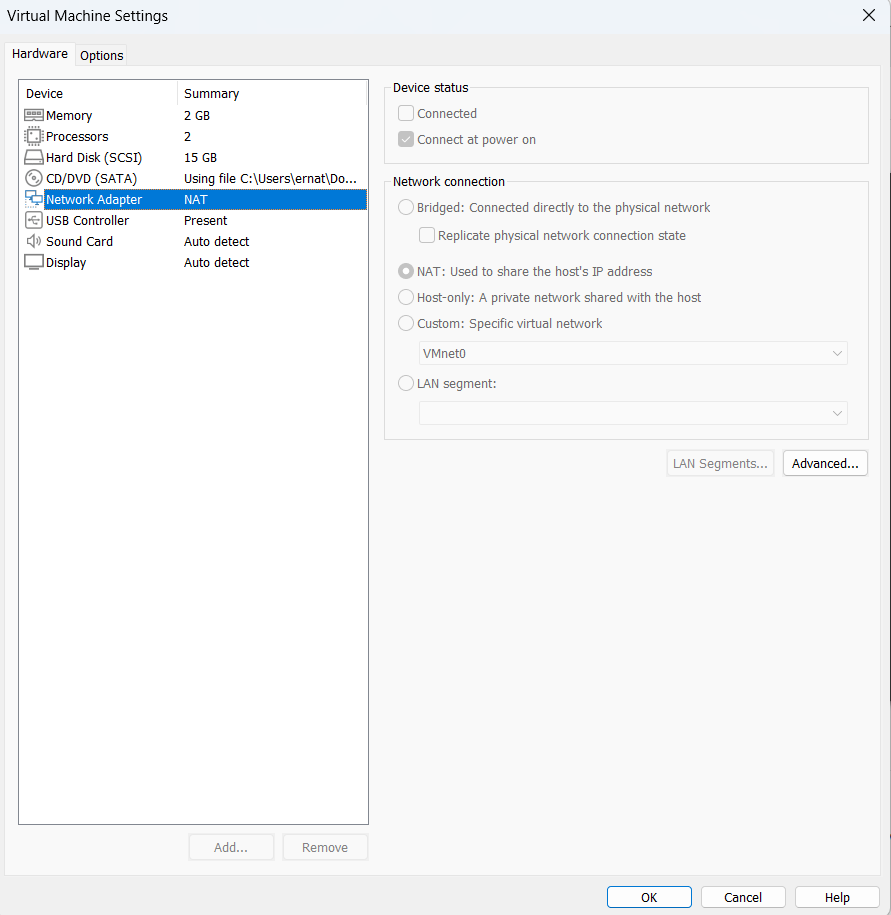
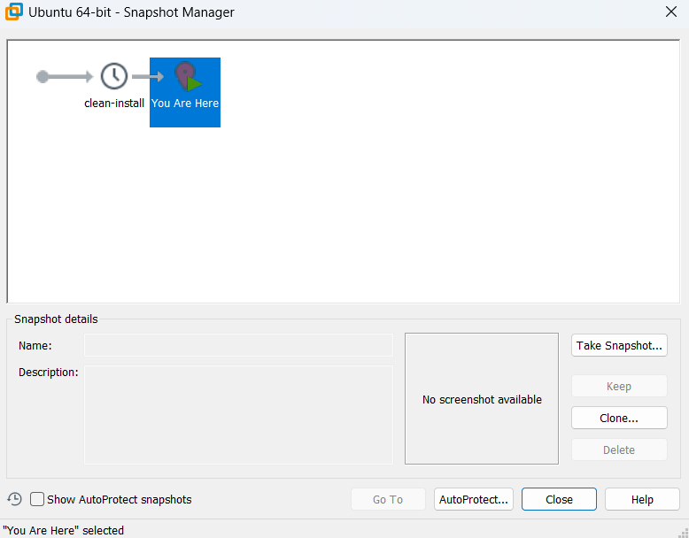

# How to build a Test Virtual Machine

Hi Aigerim, here is the step-by-step guide to setting up a safe testing environment for the new developer. We will use VirtualBox and Ubuntu Linux, as it's free, reliable, and industry-standard for testing.

## Step 1. Prepare the Software
1. Download and install **VirtualBox** (the program that runs the virtual machine).
2. Download the **Ubuntu Desktop ISO** file from the official Ubuntu website (this is the installation file for the operating system).

## Step 2. Create the Virtual Machine
1. Open VirtualBox and click **New**.
2. Name it "Dev-Test-Machine" and select the Ubuntu ISO you downloaded.
3. For CPU and Memory, allocate **2 CPUs** and **2048 MB (2 GB) of RAM**. 
   *Why these settings:* 2 GB of RAM and 2 cores are enough for basic code testing, but low enough that it won't slow down your own computer while the VM is running.

## Step 3. Configure the Disk
1. Allocate **20 GB** for the Virtual Hard disk.
   *Why 20 GB:* A standard Ubuntu installation takes about 10-15 GB. 20 GB gives the developer enough extra space to install tools and write code without running out of room.

## Step 4. Configure the Network
1. Go to the VM Settings -> Network.
2. Ensure it is set to **NAT**.
   *Why NAT:* NAT allows the virtual machine to access the internet to download updates and packages, but keeps it hidden from the rest of the office network. This ensures the test machine is secure.

## Step 5. Final Setup and Snapshot
1. Start the VM and follow the default Ubuntu installation steps (just click Next). 
2. Once installed, open the terminal in the VM and check the connection.
3. **Crucial Step:** Once everything is working, go to VirtualBox -> Machine -> **Take Snapshot**. Name it "Clean Install".
   *Why a snapshot:* If the new developer accidentally breaks the system while testing, you don't need to reinstall everything. You can just click "Restore Snapshot" to instantly bring it back to this clean state.

